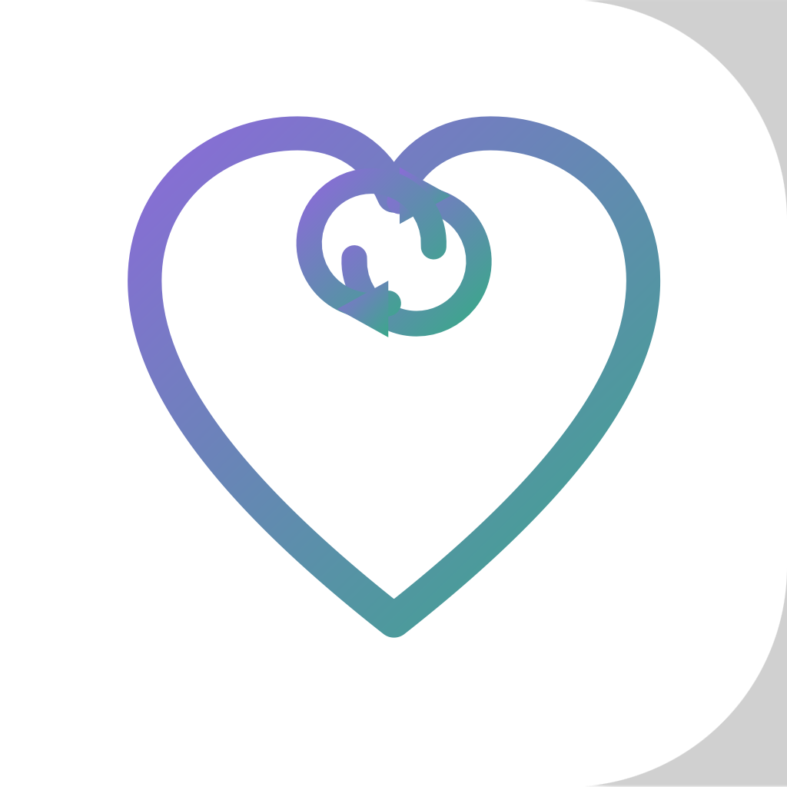
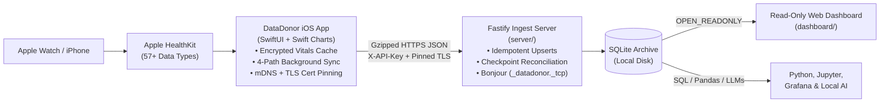

<div align="center">



# DataDonor

**Own every heartbeat. Self-hosted Apple HealthKit telemetry, on-device biometric intelligence, and zero-cloud background sync.**

<p>
  <a href="https://github.com/tsella/datadonor/actions/workflows/ci.yml">
    
  </a>
  
  
  <a href="LICENSE">
    
  </a>
  <a href="https://github.com/tsella/datadonor/commits/main">
    
  </a>
  <a href="https://github.com/tsella/datadonor/stargazers">
    
  </a>
</p>

<p>
  
  
  
  
  
</p>

<p>
  <a href="#why-datadonor">Why DataDonor?</a> •
  <a href="#on-device-vitals-dashboard">On-Device Vitals</a> •
  <a href="#architecture">Architecture</a> •
  <a href="#supported-healthkit-metrics">57+ Metrics</a> •
  <a href="#quick-start">Quick Start</a> •
  <a href="#background-sync-engine">Background Sync</a> •
  <a href="#security--privacy">Security</a>
</p>

</div>

---

## Why DataDonor?

Your Apple Watch and iPhone collect some of the richest longitudinal biometric data you will ever generate — heart rate, HRV, sleep stages, sleeping wrist temperature, VO₂ max, workouts, TDEE, and gait dynamics — yet Apple Health locks it behind manual multi-gigabyte XML exports or third-party cloud subscriptions.

**DataDonor breaks your biometrics out of the silo without ever touching the cloud.**

It pairs a native **SwiftUI iOS app** with a lightweight **local Fastify + SQLite ingest server** and a **read-only web dashboard**. Once paired over your LAN with a single QR code scan, DataDonor silently streams incremental HealthKit deltas in the background into an open SQLite database you own forever — ready for Python notebooks, Grafana, custom dashboards, or local AI/LLM health analysis — while giving you a fast, calm, on-device vitals dashboard right on your iPhone.

### Built For
- **Self-Hosters & Homelab Builders** who want local-first telemetry on a Raspberry Pi, Mac Mini, or NAS with zero cloud dependencies.
- **Quantified Self & Longevity Enthusiasts** tracking HRV trends, sleep architecture, readiness, and TDEE over months and years.
- **Data Scientists & AI Tinkerers** who want clean, deduplicated, queryable SQLite tables instead of parsing 2 GB Apple Health XML dumps.
- **Privacy Advocates** who refuse to upload medical and biometric data to third-party servers.

---

## On-Device Vitals Dashboard

DataDonor isn't just a headless uploader — the iOS client (`v1.5`) ships with a fast, offline-first biometric dashboard powered by **Swift Charts**, **off-MainActor aggregation**, and **device-lock encrypted snapshot caching** (`NSFileProtectionComplete`):

| Card | What You See |
| --- | --- |
| **Heart Rate (24h)** | Continuous heart-rate curve with 15-minute min–max range bars, dashed **RHR** baseline, **HRV** indicator, shaded **Sleep & Activity** overlay bands, total duration pills, and hold-and-drag scrubbing. |
| **Sleep Architecture (24h)** | Multi-writer deduplicated hypnogram (**Awake / REM / Core / Deep**) with union-merged intervals (no double-counting across Watch + third-party apps), stage distribution bar, and sleep efficiency. |
| **Daily Readiness (0–100)** | Personal recovery score calibrated against your own rolling **14-day baselines** across HRV, RHR, sleep duration & restorative share, and sleeping wrist temperature. |
| **Energy (TDEE & Basal)** | 7-day stacked **Basal + Active = TDEE** breakdown using HealthKit's deduplicated `HKStatisticsCollectionQuery`, completed-day average reference line, and day-by-day scrubbing. |
| **Sync History & Telemetry** | Monthly stacked record breakdown (Heart Rate, Steps, Sleep, Workouts) with category filtering, pinned header with one-tap Sync/Stop, persistent card folding, and a 120Hz GPU-accelerated ECG launch splash. |

---

## Architecture



### Repository Layout

```text
client/                    Native SwiftUI iOS app (HealthKit engine, vitals cards, TLS pinning, XCTest)
server/                    Fastify HTTPS ingest API, mDNS advertiser, QR key generator & SQLite archive
dashboard/                 Read-only web dashboard (opens databases strictly with OPEN_READONLY)
ecosystem.config.js        PM2 process manifest for running server + dashboard together
STATE_MACHINES.md          Formal audit of iOS sync, upload, BGTask & discovery state machines
server_specification.md    Wire protocol, JSON payload schemas, gzip limits & checkpoint mechanics
data_analysis_examples.md  Python & Pandas recipes for plotting HR overlaid with sleep and workouts
```

---

## Supported HealthKit Metrics

DataDonor extracts **57 HealthKit data types** (48 quantity series, 8 category streams, plus structured workouts) with standardized units and idempotent checkpoint syncing:

| Category | Metrics Included |
| --- | --- |
| **Cardiovascular & Recovery** | Heart Rate, Resting Heart Rate (RHR), Walking Heart Rate Average, Heart Rate Variability (HRV SDNN), Heart Rate Recovery (1 min), VO₂ Max, Blood Oxygen (SpO₂), Atrial Fibrillation Burden, Blood Pressure (Systolic & Diastolic) |
| **Sleep & Vitals** | Sleep Stages (Awake / REM / Core / Deep / Unspecified), Sleeping Wrist Temperature *(iOS 16+)*, Sleeping Breathing Disturbances *(iOS 18+)*, Respiratory Rate, Body Temperature, Blood Glucose |
| **Activity, Energy & Workouts** | Workouts (with activity type, duration & active kcal), Active Energy Burned, Basal Energy Burned (BMR/TDEE), Step Count, Flights Climbed, Exercise Time, Move Time, Stand Time & Stand Hours, Distance (Walking/Running, Cycling, Swimming, Downhill Snow Sports), Swimming Stroke Count, Physical Effort *(iOS 17+)*, Workout Effort Scores *(iOS 18+)* |
| **Body & Nutrition** | Body Mass, Height, BMI, Body Fat Percentage, Lean Body Mass, Dietary Energy Consumed, Dietary Water |
| **Mobility & Gait** | Walking Speed, Walking Step Length, Walking Asymmetry, Double Support Time, Apple Walking Steadiness, Number of Times Fallen |
| **Environment & Clinical Events** | Time in Daylight *(iOS 17+)*, Environmental & Headphone Audio Exposure, UV Exposure, Underwater Depth & Water Temperature, Mindful Sessions, Menstrual Flow, Irregular Rhythm / High HR / Low HR / Audio Exposure Events |

*(Static HealthKit characteristics such as Date of Birth and Biological Sex use separate non-sample APIs and can be added on request.)*

---

## Quick Start

### 1. Start the Local Server & Dashboard

```bash
# Install dependencies
cd server && npm install
cp config.json.example config.json   # Set a strong security.api_key!

cd ../dashboard && npm install
cd ..

# Launch both services with PM2 (or run `npm start` inside server/ directly)
pm2 start ecosystem.config.js
```

> **Note:** `server/config.json` refuses to boot while the example API key is still in place. Relative paths resolve against `server/`. Override paths via `DATADONOR_CONFIG` and `DATADONOR_LOG_DIR`.
> If your npm policy blocks native install scripts for `sqlite3`, run `npm rebuild sqlite3 --foreground-scripts` inside `server/` (and `dashboard/`).

### 2. Deploy the iOS App to Your iPhone

Apple requires signing with an Apple Developer account (free Personal Team works for 7-day sideloading; paid membership gives 1-year provisioning) to enable **HealthKit** and **Background Delivery** on a physical device:

1. Open `client/DataDonor.xcodeproj` in Xcode.
2. Select the **DataDonor** target → **Signing & Capabilities** → choose your Team.
3. Verify **HealthKit** (with **Background Delivery**) is enabled with no signing errors.
4. Select your iPhone as the destination and press **Cmd + R**.

### 3. Pair Instantly via QR Code

Skip typing long API keys on your phone:

```bash
cd server && npm run qr
```

1. DataDonor automatically discovers your server on your LAN via Bonjour (`_datadonor._tcp`).
2. Approve the discovered server in the app (this pins its TLS public key).
3. Open **Settings** in the app, tap the **QR icon** next to the API Key field, and scan the terminal QR code.

---

## Background Sync Engine

iOS aggressively throttles background networking, so DataDonor combines **four coordinated wake paths** (fastest first) and backs them with deterministic state machines documented in [`STATE_MACHINES.md`](STATE_MACHINES.md):

1. **Synchronous Multi-Type `HKObserverQuery` (`.immediate`)** — Registered inside `didFinishLaunchingWithOptions` across high-priority vitals (HR, steps, active energy, RHR, HRV, sleep, workouts, body mass, SpO₂, respiratory rate, blood pressure, glucose, nutrition, mindfulness, cycle). Syncs newly arrived types first, then opportunistically runs a batched full-catalog sweep if due (30+ min) or if an earlier wake was deferred while locked or away from home.
2. **Unlock Catch-Up (`protectedDataDidBecomeAvailableNotification`)** — Drains any locked-device deferred sync the instant you unlock your iPhone while the process is resident.
3. **Periodic Delta Sweep (`BGAppRefreshTask`)** — `la.tsel.datadonor.backgroundSync` (15-minute floor) for batched incremental deltas.
4. **Full Reconciliation (`BGProcessingTask`)** — `la.tsel.datadonor.fullSync` (1-hour floor) for complete catalog verification.

**Why it stays reliable:**
- Background wakes use an **immediate (non-discretionary) `URLSession`** so iOS doesn't park tiny uploads in `nsurlsessiond`'s overnight queue, while manual foreground backfills use `URLSessionConfiguration.background` so huge historical exports finish even if you switch apps.
- Server checkpoints advance **only after a 2xx server acknowledgement**, guaranteeing at-least-once delivery with idempotent server deduplication.
- If background mDNS stalls, the client falls back to its **last resolved LAN IP while still enforcing strict pinned-key TLS**.
- Failure notifications trigger only after **three consecutive failed runs** and clear automatically on the next clean sync.

<details>
<summary><strong>Debugging background tasks in Xcode</strong></summary>

Pause the debugger in Xcode and run:

```lldb
e -l objc -- (void)[[BGTaskScheduler sharedScheduler] _simulateLaunchForTaskWithIdentifier:@"la.tsel.datadonor.backgroundSync"]
```

Incoming batches appear in `server/logs/datadonor-*.log` as `Ingested N new metric(s)`, and empty wakes still record a heartbeat.

</details>

---

## Data Analysis & Read-Only Dashboard

- **Read-Only Web Dashboard (`dashboard/`)** — Opens the SQLite archive strictly with `OPEN_READONLY` (any write attempt throws at the SQLite layer) for safe range exploration over your health archive and meal logs.
- **Python & AI Workflows** — See [`data_analysis_examples.md`](data_analysis_examples.md) for turnkey Python/Pandas examples (e.g., plotting heart rate overlaid with sleep and workout intervals) and [`server_specification.md`](server_specification.md) for the exact ingest API & schema.

---

## Testing

All three components ship with self-contained automated test suites:

```bash
# Server: auth, ingest idempotency, gzip limits, bucket rollups
cd server && npm test

# Dashboard: read-only unit tests against a throwaway SQLite database
cd dashboard && npm test

# iOS Client: 31 state-machine, cache & vitals regression tests (macOS + Xcode)
xcodebuild test -project client/DataDonor.xcodeproj -scheme DataDonor \
  -destination 'platform=iOS Simulator,name=iPhone 17 Pro' CODE_SIGNING_ALLOWED=NO
```

---

## Security & Privacy

- **Explicit Server Approval & TLS Public-Key Pinning** — Discovered mDNS servers require one-time user approval. Self-signed LAN certificates work seamlessly, while any substituted certificate is rejected.
- **Encrypted On-Device Cache** — Cached vitals snapshots are written atomically with `NSFileProtectionComplete`, matching HealthKit's own device-lock encryption.
- **Read-Only Consumer Isolation** — The web dashboard never holds write handles to your archive.

> [!IMPORTANT]
> **Self-Hosting Responsibility:** DataDonor extracts sensitive personal, medical, and biometric telemetry from Apple's sandbox and sends it to your own infrastructure. **Securing your server is entirely your responsibility** — keep it firewalled on a private LAN/VPN, encrypt disks at rest, and protect your API key and TLS private keys. The authors are not responsible for data leaks or breaches once data leaves the iOS sandbox.

---

## License

Released under the [MIT License](LICENSE).
